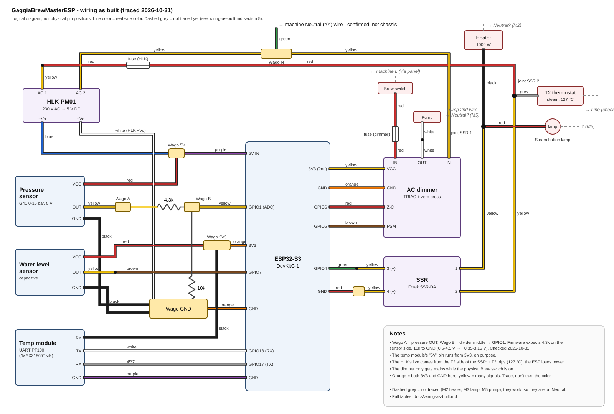
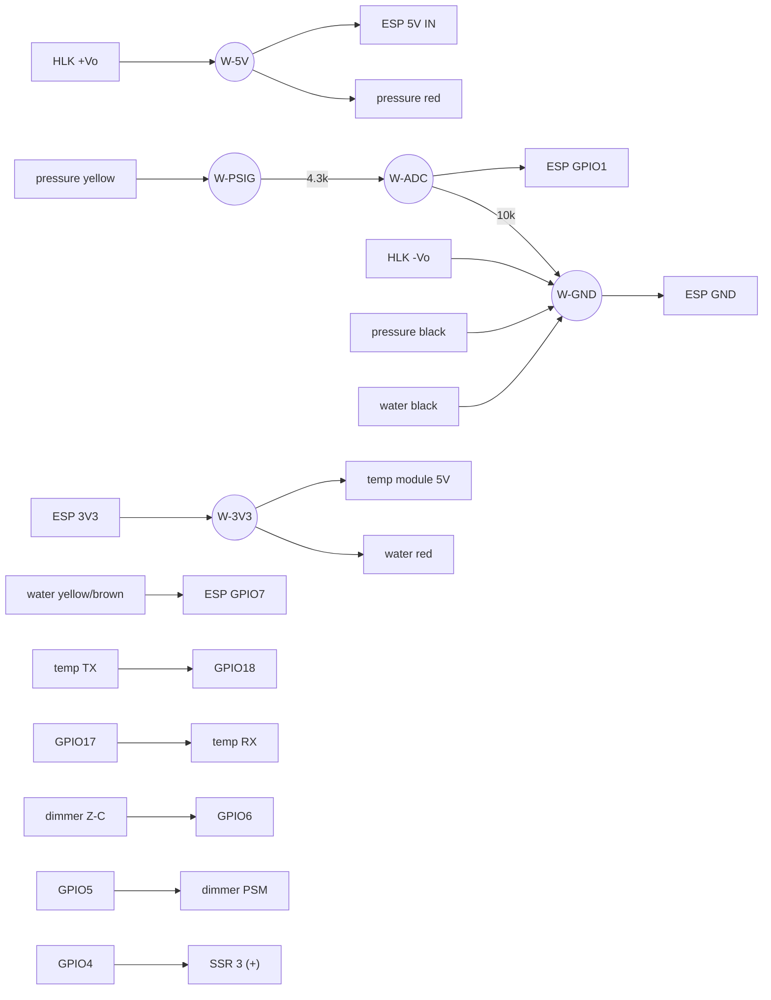

# Wiring as built (traced by the user, 2026-10-31)

The machine's real wiring, wire by wire, from the user's own walk-through
with the machine unplugged. Where this file and an older plan disagree, this
file wins. Update it whenever a wire moves.

**Diagram:** [wiring-diagram.svg](wiring-diagram.svg)



Wire colors are the colors of the wires actually used, not a standard.
**Orange is used for both 3V3 and GND, and yellow for many different
signals.** Always trace a wire end to end; don't go by color.

## 1. Low-voltage side

### Junction nodes (Wago connectors)

| Node | What it is | Wires in it |
|------|------------|-------------|
| **W-5V** | 5V rail from the HLK-PM01 | blue (HLK **+Vo**), purple (→ ESP **5V IN**), red (pressure sensor VCC) |
| **W-PSIG** | Pressure sensor output | yellow (pressure sensor OUT), **4.3k** resistor (other leg → W-ADC) |
| **W-ADC** | Divider midpoint | 4.3k (from W-PSIG), **10k** (other leg → W-GND), yellow (→ ESP **GPIO1**) |
| **W-GND** | Common ground | white (HLK **−Vo**), black (pressure sensor GND), black (water sensor GND), 10k (from W-ADC), orange (→ ESP **GND**) |
| **W-3V3** | 3V3 rail from the ESP | orange (← ESP **3V3**), black (→ temp module "5V" pin), red (water sensor VCC) |
| **W-SSR−** | SSR control ground | yellow (SSR terminal 4), red (→ ESP **GND**) |

The part between W-ADC and W-GND is the 10k resistor (checked 2026-10-31).
The HLK −Vo wire was called grey once and white once (color only).

### Pressure divider (0-16 bar sensor → GPIO1)

```
HLK +Vo ──┬── ESP 5V IN
          └── sensor red (VCC)

sensor yellow (0.5-4.5 V) ── 4.3k ──┬── ESP GPIO1   (×10/14.3 = max ~3.15 V)
                                    10k
                                     │
HLK −Vo ── sensor black ── water black ── ESP GND   (all in W-GND)
```

The **4.3k must be on top** (sensor side) and the **10k on the bottom**
(ground side). Swapped, the reading can never go above ~1353 mV.

### Per component

| Component | Pin | Wire | Goes to |
|-----------|-----|------|---------|
| **Pressure sensor** (G41 1.6 MPa, 5V) | red VCC | red | W-5V |
| | yellow OUT | yellow | W-PSIG → 4.3k → W-ADC → GPIO1 |
| | black GND | black | W-GND |
| **Water level sensor** (capacitive) | red VCC | red | W-3V3 |
| | yellow OUT | yellow → brown | ESP **GPIO7** |
| | black GND | black | W-GND |
| **Temp module** (UART PT100, "MAX31865" silkscreen) | 5V | black | W-3V3 (runs on 3V3, as before) |
| | TX | white | ESP **GPIO18** (RX) |
| | RX | grey | ESP **GPIO17** (TX) |
| | GND | purple | ESP GND |
| **Dimmer** (logic side) | VCC | yellow | ESP 3V3 (the second 3V3 pin) |
| | GND | orange | ESP GND |
| | Z-C | red | ESP **GPIO6** |
| | PSM | brown | ESP **GPIO5** |
| **SSR** (control side) | 3 (+) | yellow → green | ESP **GPIO4** |
| | 4 (−) | yellow | W-SSR− → red → ESP GND |
| **HLK-PM01** (DC side) | +Vo | blue | W-5V |
| | −Vo | white (or grey) | W-GND |

ESP pins used: GPIO1, 4, 5, 6, 7, 17, 18, 5V IN, both 3V3 pins, GND (several).

### Checked against the firmware (2026-10-31)

| Wire | Firmware | Match |
|------|----------|-------|
| SSR + → GPIO4 | `PIN_SSR 4`, OUTPUT | yes |
| Dimmer PSM → GPIO5 | `PIN_DIMMER_GATE 5`, OUTPUT | yes |
| Dimmer Z-C → GPIO6 | `PIN_DIMMER_ZC 6`, INPUT_PULLUP, rising-edge interrupt | yes |
| Pressure divider → GPIO1 | `PIN_PRESSURE_ADC 1`, plain INPUT; the math assumes **4.3k top / 10k bottom** | yes, if the 4.3k is the one on the sensor side |
| Water OUT → GPIO7 | `PIN_WATER_LEVEL 7`, INPUT_PULLUP, LOW = water | yes |
| Temp module TX → GPIO18 | `PIN_SENSOR_RX 18` | yes |
| Temp module RX ← GPIO17 | `PIN_SENSOR_TX 17` | yes |
| Temp module power from 3V3 | `config.h` comment: "module 5V -> ESP 3V3" | yes |

## 2. Mains side (230 V)

| Component | Terminal | Wire | Goes to |
|-----------|----------|------|---------|
| **SSR** (load side) | 2 | yellow | joint with machine **grey** (→ steam thermostat T2) and **red** (→ fuse → yellow → HLK AC side 1) |
| | 1 | yellow | joint with machine **black** (→ heater element) and **red** (→ Steam button lamp) |
| **HLK-PM01** (AC side) | AC 1 | yellow | red → fuse → SSR terminal 2 / T2 |
| | AC 2 | yellow | N Wago (with dimmer N and the machine's green wire) |
| **Dimmer** (mains side) | IN | red | fuse → Brew switch output |
| | OUT | white | white → pump |
| | N | yellow | N Wago (with HLK AC 2 and the machine's green wire) |
| **N Wago** | | yellow (HLK AC 2), yellow (dimmer N), green | green → the machine's Neutral ("0") wire, not the chassis (confirmed 2026-10-31) |

What this would mean, **if** the unverified points in section 5 check out:

- Heater path: L → T2 (127 °C) → SSR 2 → SSR 1 → heater → N. T2 is on
  terminal 2 and the heater on terminal 1, the reverse of Section 7's plan.
  An AC SSR doesn't care which way round. Where T2's other terminal and
  the heater's other terminal go was not described (M1, M2).
- The HLK takes its live from the T2 side of the SSR, through its own fuse.
  So if T2 trips (~127 °C) the HLK, and with it the ESP32, loses power.
  Known and accepted (2026-10-20).
- A red wire to the Steam button lamp is on SSR terminal 1, the heater side.
  It is only a heating indicator if its other leg goes to Neutral (M3).
- The pump only gets power while the physical Brew switch is on, and then
  only when the dimmer fires. Where the pump's other wire goes was not
  described (M5).

## 3. Low-voltage diagram



## 4. Open issues found while documenting (2026-10-31)

1. **Red wire to an empty Wago: removed (2026-10-31).** It came off W-3V3
   and went to a Wago with nothing else in it. Almost certainly the old
   0-5 bar sensor's 3V3 supply. The user pulled it out, and the empty Wago
   is gone.
2. **Machine "0" / green wire: resolved.** The user confirmed the green wire
   (from the HLK AC-2 / dimmer N Wago) joins the machine's Neutral ("0")
   wire, not the chassis. Its green color is just the wire used; it is
   not an earth.
3. **Pressure stuck at ~5.7 bar.** See the diagnosis in `AGENTS.md`'s
   change log (2026-10-31).

## 5. To check (description incomplete or self-contradicting)

Items marked done are checked; the rest are open. Machine unplugged for every check except V1-V3.

**Low voltage**

- **L1, L3, L4 - done (2026-10-31).** The part between W-ADC and W-GND is a
  resistor; 4.3k on the sensor side, 10k to GND (the order the firmware
  assumes); the W-3V3 orange is on a 3V3 pin and the W-GND orange on a GND pin.
- **L5 - done (2026-10-31).** The dangling red came off W-3V3; removed.
- **L2** HLK −Vo wire: grey or white? (Color only; it lands in W-GND either way.)
- **L6** Pressure sensor red really in W-5V, black really in W-GND (not swapped).
- **L7** Continuity, 0 Ω: ESP GPIO1 pin ↔ W-ADC; ESP GND ↔ W-GND;
  ESP GND ↔ HLK −Vo.

**Mains**

- **M1 - done (2026-10-31).** Grey from SSR 2 lands on one T2 terminal, the other T2 terminal goes to Line, nothing bypasses T2.
- **M2** Heater second terminal → Neutral: not traced, but the heater works, so it is on Neutral.
- **M3** The red wire on SSR terminal 1 to the Steam lamp: where does the
  lamp's other leg go?
- **M4 - done (2026-10-31).** The green wire joins the machine's Neutral
  ("0") wire, not the chassis.
- **M5** Where does the pump's second wire (originally blue) go? It should
  be Neutral.
- **M6** Ratings of the two fuses (HLK feed, dimmer IN). The install guide
  says 0.5 A for the HLK, and the 2026-10-01 log says 2 A for the dimmer.

**With power on (5V side only, probe to W-GND)**

- **V1** W-5V: ~5 V.
- **V2** W-PSIG (sensor out) at rest after venting the pressure: ~0.3-0.5 V.
- **V3** W-ADC: about 0.7 x V2.
