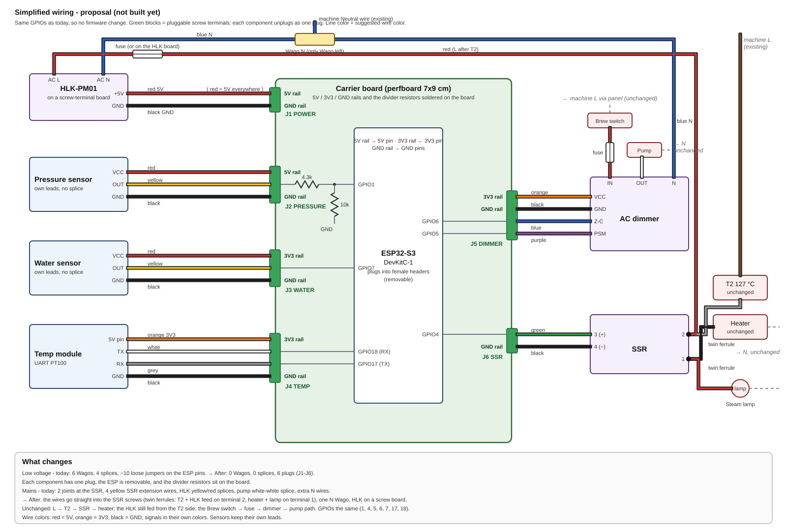

# Simplified wiring - proposal (2026-10-31, not built)

Goal: fewer joints inside the machine and a layout you can service. Every
GPIO stays the same, so **no firmware change**. Today's wiring is in
[wiring-as-built.md](wiring-as-built.md).

## Idea

**Low voltage:** a carrier board (perfboard) holds the ESP32 in female
headers and has the 5V / 3V3 / GND rails and the pressure divider soldered
on. Each component plugs in with one pluggable screw terminal:

| Plug | Pins | Component |
|------|------|-----------|
| J1 POWER | 5V, GND | HLK-PM01 +Vo / −Vo |
| J2 PRESSURE | 5V, SIG (→ 4.3k → GPIO1, 10k → GND on the board), GND | pressure sensor red / yellow / black |
| J3 WATER | 3V3, OUT → GPIO7, GND | water sensor red / yellow / black |
| J4 TEMP | 3V3, TX → GPIO18, RX ← GPIO17, GND | temp module 5V pin / TX / RX / GND |
| J5 DIMMER | 3V3, GND, Z-C → GPIO6, PSM ← GPIO5 | dimmer logic side |
| J6 SSR | GPIO4, GND | SSR 3 (+) / 4 (−) |

This removes all 6 low-voltage Wagos, the 4 splices and the loose jumpers
on the ESP pins.

**Mains (topology unchanged, fewer joints):**

- SSR terminal 2: the T2 grey and the HLK feed (via its fuse) in **one twin
  ferrule**, straight into the screw. No joint, no yellow extension wire.
- SSR terminal 1: the heater black and the Steam lamp red in one twin ferrule.
- HLK-PM01 on a screw-terminal carrier board: no soldered pigtails. If the
  board has its own fuse, the inline HLK fuse can go.
- The dimmer OUT goes straight to the pump's white wire (no splice). IN
  stays: Brew switch → fuse → IN.
- Neutral: one Wago N (machine N + HLK AC N + dimmer N). It's the only
  Wago left.

The mains path itself doesn't change: L → T2 → SSR → heater, the HLK still
fed from the T2 side, and Brew switch → fuse → dimmer → pump. The mains
can't be simplified further without losing T2 or the fuses.

## Shopping list

| # | Part | Qty | Note |
|---|------|-----|------|
| 1 | Double-sided perfboard, 7x9 cm | 1 | the carrier board |
| 2 | Female header 2.54 mm, 1x22 (or longer, cut) | 2 | ESP32-S3 DevKitC-1 plugs in. Check its row spacing before soldering |
| 3 | Pluggable terminal blocks 5.08 mm (2EDG / KF2EDGK), PCB socket + plug | 2-pin x2, 3-pin x2, 4-pin x2 | J1-J6. An assortment kit is cheapest |
| 4 | Ferrule kit 0.5-1.5 mm² **including twin ferrules** (2x0.75 / 2x1.0) + crimper | 1 | the SSR screws and the terminal plugs |
| 5 | HLK-PM01 screw-terminal carrier board (with fuse + varistor if possible) | 1 | keeps the existing HLK, or buy one fitted |
| 6 | 22 AWG wire: red, orange, black + a few signal colors | 1 m each | red = 5V, orange = 3V3, black = GND |
| 7 | Solid tinned wire for the rails on the board | 1 m | |
| - | Already on hand: 4.3k + 10k resistors, Wago 221, heat-shrink, inline fuses | | |
| opt | Small ABS project box ~100x70x30 mm | 1 | for the carrier board |
| opt | Spiral wrap / cable ties | | keeps the low-voltage bundle away from mains and the boiler |

Needs a soldering iron.

**No-solder alternative:** a screw-terminal breakout for the ESP32-S3
DevKitC-1 (44-pin) plus one 5-way Wago (221-415) as a GND bus. If its rails
don't have enough screws, add a 3-way Wago for 3V3. The divider resistors
then go straight into the breakout's screws. Fewer plugs, but no soldering.

## Build order (machine unplugged)

1. Build the carrier board on the bench. With a multimeter: no short
   between 5V / 3V3 / GND; 4.3k J2 SIG → GPIO1 pad; 10k GPIO1 pad → GND.
2. Plug the ESP in, power it over USB only, nothing connected to J1-J6:
   check that it boots and is reachable (`/status`).
3. In the machine, move one component at a time onto its plug and check
   `/status` after each: temp, water, pressure, dimmer (pump with the Brew
   switch), SSR (heater).
4. Mains: redo SSR terminals 1 / 2 with twin ferrules, HLK on its carrier,
   the dimmer OUT → pump straight, one N Wago. Check the screws are tight
   and nothing is bare.
5. First power-up supervised, as in AGENTS.md Section 7 step 9. Then update
   `wiring-as-built.md` and `wiring-diagram.svg` to match.
